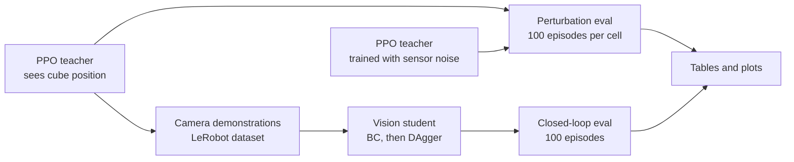

# autorl-demo


A simulated robot arm learns to pick up a cube and hold it at a target, by trial and error, in under 30 minutes. I tested where that policy breaks. Then I trained a second policy that only gets a camera image, by having it imitate the first one.

What I found:

- The arm learns fast. In 27 minutes of training it goes from 0% to 100% of attempts ending within 2 cm of the target, 0.3 cm away on average.
- It breaks at specific points. A cube 5 times heavier is fine (94%) and one 10 times heavier is not (3%). Sensor noise wears it down steadily: 100, 97, 65, 28 and 1% as the noise goes from 0x to 1x, 2x, 3x and 5x.
- A camera-only student can copy it. With 500 demonstrations it succeeds 44% of the time. With 1,250 it reaches 93%, against 100% for the teacher that is told where the cube is.

In the clip above both policies start from the same cube position and goal. The teacher ends 0.06 cm from the goal and the student 1.46 cm.

## Why

This is a first step toward generating robot training data with simulation and reinforcement learning instead of human teleoperation. A simulated policy can produce as many demonstrations as I need and be scored with no person in the loop.

## What I built

The lift task and the PPO training are stock Isaac Lab. I did not design the task, the rewards or the training algorithm. I built the evaluation (end-of-episode success under perturbations), the noise-training study, and the student pipeline (camera data, LeRobot export, behavior cloning, DAgger, closed-loop evaluation).

## Pipeline



## Part 1: the teacher

### Training

The task is Isaac Lab's `Isaac-Lift-Cube-Franka-v0`: a Franka Panda picks up a cube and holds it at a goal position for a 5-second episode. The teacher reads 36 numbers (joint state, cube position, goal, last action) and outputs 8 (7 arm joint targets and a gripper command). I trained it with PPO for 1500 iterations on 4096 parallel environments, 27 minutes on one RTX 3090.


The baseline reaches a mean episode reward of 152.2. The second line is the noise-trained policy below.

### How I evaluate

Success means the cube ends the episode within 2 cm of the goal. Each cell is 100 episodes with the same seed, so every cell sees the same goals. With 100 episodes, a rate near 50% carries about ±10 points of sampling uncertainty. The plots show 95% Wilson intervals.

I perturb one thing at a time: cube mass, friction of the cube and fingers, noise on the observations (1x is 0.01 rad on joint positions, 0.1 rad/s on joint velocities, 1 cm on cube position), noise on the actions, and the size of the cube's spawn area.

### Robustness

The final policy handles a cube up to 5 times heavier (94%) but fails at 10 times (3%), and friction has the same kind of cliff: 99% at half friction, 65% at 0.2x, 2% at a tenth. Sensor noise wears it down steadily instead, while action noise and a wider spawn area are tolerated best (80% and 83% at the strong levels). More training buys robustness as well as precision: at 5x mass the iteration-500 policy keeps 57% of its own unperturbed success (41 of 72), and the final policy keeps 94%.


<details>
<summary>Full robustness table (16 rows)</summary>

Success rate [%] by training checkpoint. Iteration 100 is 0% in every row.

| Perturbation | Level | iter 300 | iter 500 | iter 1499 |
|---|---|---|---|---|
| None | none | 1 | 72 | 100 |
| Cube mass | x2 | 2 | 65 | 100 |
| | x3 | 2 | 58 | 97 |
| | x5 | 2 | 41 | 94 |
| | x10 | 1 | 0 | 3 |
| Friction (cube + fingers) | x0.5 | 4 | 72 | 99 |
| | x0.2 | 1 | 29 | 65 |
| | x0.1 | 0 | 0 | 2 |
| Observation noise | x1 | 1 | 54 | 97 |
| | x2 | 1 | 30 | 65 |
| | x3 | 0 | 8 | 28 |
| | x5 | 0 | 0 | 1 |
| Action noise | medium (std 0.1) | 1 | 68 | 99 |
| | strong (std 0.5) | 1 | 39 | 80 |
| Spawn range | medium (x1.5) | 3 | 65 | 99 |
| | strong (x2) | 0 | 60 | 83 |

Precision arrives late. At iteration 300 the policy already lifts the cube (9 cm from the goal on average, down from 77 cm at iteration 100), but only 1% of episodes end within 2 cm.

Mean final distances are in [`results/eval_matrix.md`](results/eval_matrix.md) and all per-cell statistics in [`results/eval_matrix_cells.csv`](results/eval_matrix_cells.csv).

</details>

### Training with noise is a tradeoff

I trained a second teacher with observation noise drawn from 0x to 3x each episode, and evaluated it after 1500 iterations (28 minutes) and again after resuming to 3000 (21 more minutes).


Success rate, with mean final distance in brackets:

| Noise | Baseline, 1500 it | Noise-trained, 1500 it | Noise-trained, 3000 it |
|---|---|---|---|
| x0 | 100% (0.31 cm) | 4% (3.49 cm) | 63% (1.93 cm) |
| x1 | 97% (0.96 cm) | 5% (3.58 cm) | 69% (1.88 cm) |
| x2 | 65% (3.91 cm) | 15% (3.19 cm) | 56% (2.88 cm) |
| x3 | 28% (12.24 cm) | 18% (3.35 cm) | 49% (4.58 cm) |
| x5 | 1% (42.39 cm) | 16% (10.76 cm) | 15% (14.42 cm) |

Noise training first made the policy robust but imprecise: it stopped 3.2 to 3.6 cm from the goal whatever the noise level. Training longer recovered most of the precision. What is left is a clear tradeoff: worse than the baseline at low noise, much better at high noise.

The training reward barely moved between 1500 and 3000 iterations (118.9 to 119.4) while the evaluated precision improved a lot. That is why I evaluate separately instead of reading results off the training curve.

Two caveats. I resumed the 3000-iteration policy from a checkpoint, which restarts the task's penalty curriculum. And I did not train the baseline to 3000 iterations.

## Part 2: the student


The right panel is everything the student sees of the scene. In this clip the first episode ends 1.46 cm from the goal. The second ends 2.40 cm away, just outside the 2 cm threshold.

### What the student gets

- One 84x84 RGB image from a fixed camera.
- 21 numbers: 9 joint positions, 9 joint velocities and the 3-number goal position.
- Not the cube position. It has to find the cube in the image.

It outputs the same 8-number action as the teacher. The model is a small CNN for the image and an MLP for the numbers, trained with a mean squared error loss on the teacher's action.

### Data

I rolled out the teacher with a little noise on its actions (std 0.1) so it visits more states, and recorded the action it wanted to take as the label. The first set is 500 episodes (125,000 frames), split 450/50 by episode.

The same 500 episodes are exported as a LeRobot dataset (format v3.0) with the instruction "pick up the cube and move it to the target", written and re-loaded with LeRobot's own code. The datasets are not in this repository.

### Results

Closed-loop, 100 episodes each, same seed and metric as the teacher's eval:

| Policy | Training episodes | Success at 2 cm | Mean final distance | Median final distance | Cube lifted |
|---|---|---|---|---|---|
| Teacher (sees cube position) | - | 100% | 0.32 cm | 0.30 cm | 100% |
| BC 500 | 500 | 44% | 8.79 cm | 2.26 cm | 85% |
| BC + more teacher data | 1250 | 93% | 2.27 cm | 0.85 cm | 97% |
| BC + DAgger round 1 | 750 | 55% | 8.22 cm | 1.75 cm | 84% |
| BC + DAgger round 2 | 1000 | 72% | 8.39 cm | 1.25 cm | 83% |
| BC + DAgger round 3 | 1250 | 88% | 3.42 cm | 0.92 cm | 95% |

The teacher's 0.32 cm here and 0.31 cm in Part 1 come from two separate runs of the same 100 episodes, which do not reproduce to the last digit. I round it to 0.3 cm in the summary.

BC is behavior cloning on teacher rollouts. In each DAgger round the current student drives for 250 episodes, the teacher labels what it should have done, and a new student is trained on everything so far. The "more teacher data" row adds 750 teacher episodes instead, so both end at 1,250.

I expected DAgger to win. At matched data, plain BC on noise-injected teacher data did about as well: 93% against 88%, one training seed each, within the sampling error of 100 episodes. My guess is that the action noise already makes the teacher visit and correct the off-course states DAgger is meant to add.

The best student still fails 7 of 100 episodes. In 3 it never grasps the cube, and in 4 it lifts it but stops 2.3 to 4.4 cm from the goal. [Here is one of the missed grasps](media/student_failure.mp4): the arm reaches past the cube and ends 44.5 cm from the goal.

More clips: [student close-up (mp4)](media/student_closeup_10s.mp4) · [teacher close-up (mp4)](logs/rsl_rl/franka_lift/2026-10-13_15-19-32_ppo_baseline/videos/play/closeup_1env_10s_clean.mp4) · [teacher, 16 environments (mp4)](logs/rsl_rl/franka_lift/2026-10-13_15-19-32_ppo_baseline/videos/play/play_16env_10s.mp4). Full table: [`results/student_comparison.md`](results/student_comparison.md).

### What the student depends on

I re-ran the best student and the teacher with changes that only affect what the camera sees: dimmer and brighter light, a different cube color, a different table color, and the camera moved sideways. Nothing was retrained. Each cell is 100 episodes with the same seed and metric as before.

| Change | Teacher success | Student success | Student mean final distance |
|---|---|---|---|
| None | 100% | 90% | 3.34 cm |
| Light intensity x0.5 | 100% | 53% | 7.72 cm |
| Light intensity x2 | 100% | 0% | 41.15 cm |
| Cube color: flat red | 100% | 20% | 28.80 cm |
| Table color: light wood | 100% | 0% | 41.57 cm |
| Camera moved 5 cm sideways | 100% | 0% | 43.09 cm |
| Camera moved 10 cm sideways | 100% | 0% | 40.23 cm |


The teacher ignores all of these, because it never looks at the image. The student depends on them completely. A brighter light, a lighter table or a camera moved by 5 cm takes it from 90% to 0%, and it mostly stops lifting the cube at all. That is why a camera-based policy trained on one fixed scene is not ready for a real robot: it needs randomized lighting, colors and camera poses in training first.

The 90% in the first row and the 93% in the student table above are two separate runs of the same 100 episodes, which do not reproduce exactly. All per-run results are in [`results/visual/`](results/visual/) and the table in [`results/visual_robustness.md`](results/visual_robustness.md).

## Limitations

- Everything is in simulation. The perturbations stand in for sim-to-real gaps.
- Each policy comes from one training run with one seed, and each number from 100 episodes. Small differences are not meaningful.
- The student's camera is fixed and the scene is plain, apart from other robots visible in the background.
- The student still gets exact joint readings and the goal as numbers. Only the cube has to come from the image.

## Next steps

- Retrain the student with randomized lighting, colors and camera poses, and re-run the table above.
- Fine-tune a vision-language-action model such as SmolVLA on the LeRobot dataset.
- Move to harder tasks like stacking, with a language model proposing the reward functions and this evaluation scoring them.

## Reproducing

<details>
<summary>Setup</summary>

Tested with Isaac Lab 2.0.2 (git tag `v2.0.2`) on Isaac Sim 4.5.0, Ubuntu 20.04, one NVIDIA RTX 3090, and a Python 3.10 conda environment with Isaac Lab installed (`./isaaclab.sh -i`), which provides `rsl-rl-lib` 2.3.3. Isaac Lab is not modified and not part of this repository.

```bash
git clone git@github.com:Jason-lab1126/autorl-demo.git
cd autorl-demo
source env.sh        # activates the environment and pins everything to one GPU
```

`env.sh` assumes Isaac Lab at `~/IsaacLab`, Isaac Sim at `~/isaac-sim`, a conda environment named `WL`, and GPU 0 (set `DEMO_GPU=<index>` before sourcing to change it).

The LeRobot export runs in a separate CPU-only environment:

```bash
conda create -n lerobot python=3.10 -y && conda activate lerobot
pip install "lerobot==0.4.4" h5py --extra-index-url https://download.pytorch.org/whl/cpu
```

</details>

<details>
<summary>Commands: teacher</summary>

Run everything from the repository root.

```bash
# train the baseline (extra arguments go to Isaac Lab's train.py)
./scripts/train_lift.sh --run_name ppo_baseline

# train with observation noise (0x to 3x per episode)
TRAIN_PY=scripts/train_lift_obs_noise.py ./scripts/train_lift.sh --run_name ppo_obs_noise

# resume that run to iteration 2999
TRAIN_PY=scripts/train_lift_obs_noise.py ./scripts/train_lift.sh --run_name ppo_obs_noise_resume \
    --resume True --load_run 2026-10-13_16-36-46_ppo_obs_noise --checkpoint model_1499.pt --max_iterations 1501

# evaluate the full matrix (about 5 minutes)
RUN=logs/rsl_rl/franka_lift/2026-10-13_15-19-32_ppo_baseline
python scripts/eval_lift.py --run_dir $RUN --headless --device cuda:0

# plots (no simulator needed); plot_compare.py and plot_training.py make the other two
python scripts/plot_eval.py

# teacher videos
python scripts/play_lift.py --task Isaac-Lift-Cube-Franka-Play-v0 --num_envs 16 --headless --device cuda:0 \
    --video --video_length 500 --checkpoint $RUN/model_1499.pt
python scripts/record_video.py --checkpoint $RUN/model_1499.pt --name closeup --no_markers \
    --eye 1.45 0.85 0.9 --lookat 0.3 0.0 0.35 --headless --device cuda:0
```

Each script's docstring shows its options. `plot_training.py` reads the TensorBoard event files, which are not committed.

</details>

<details>
<summary>Commands: student</summary>

```bash
TEACHER=logs/rsl_rl/franka_lift/2026-10-13_15-19-32_ppo_baseline/model_1499.pt

# collect 500 teacher episodes with camera images
python scripts/collect_lift_vision.py --checkpoint $TEACHER --num_envs 125 --episodes_per_env 4 \
    --out datasets/lift_vision_raw.h5 --headless --device cuda:0

# behavior cloning, then closed-loop eval
python scripts/train_student.py --data datasets/lift_vision_raw.h5 --out logs/student/bc_500ep --epochs 20
python scripts/eval_student.py --student logs/student/bc_500ep/student.pt --out_dir results/student_bc \
    --headless --device cuda:0

# the teacher in the same camera environment
python scripts/eval_student.py --policy teacher --checkpoint $TEACHER \
    --out_dir results/student_bc/teacher_reference --headless --device cuda:0

# DAgger rounds, the matched "more teacher data" run and the comparison table
./scripts/run_student_experiments.sh

# export to LeRobot format and validate
conda activate lerobot
python scripts/export_lerobot.py --raw datasets/lift_vision_raw.h5 --root datasets/lift_cube_franka_lerobot

# visual changes: best student and teacher, 7 conditions
./scripts/run_visual_eval.sh

# record a student rollout
python scripts/record_student_video.py --policy student --student logs/student/bc_more_teacher/student.pt \
    --out_prefix media/raw/student_seed0 --headless --device cuda:0
```

</details>

<details>
<summary>Repository layout</summary>

| Path | Contents |
|---|---|
| `env.sh` | Environment setup and GPU pinning |
| `scripts/` | Training, evaluation, plotting, data collection, student and video scripts |
| `results/` | Eval tables, plots, training-curve values, the student comparison, the visual-change eval (`visual/`) and per-episode results |
| `media/` | GIFs and clips used here; `clips.json` records how each clip ended |
| `logs/student/` | Student checkpoints, training logs and configs |
| `logs/rsl_rl/franka_lift/` | The three teacher runs: baseline (checkpoints 100, 300, 500, 1499, exported policy, two videos), noise-randomized, and its resume to 3000 iterations (`model_2999.pt`) |

</details>

<details>
<summary>Task details</summary>

The task is defined in Isaac Lab 2.0.2 in [`lift_env_cfg.py`](https://github.com/isaac-sim/IsaacLab/blob/v2.0.2/source/isaaclab_tasks/isaaclab_tasks/manager_based/manipulation/lift/lift_env_cfg.py) (observations, rewards, terminations) and [`config/franka/joint_pos_env_cfg.py`](https://github.com/isaac-sim/IsaacLab/blob/v2.0.2/source/isaaclab_tasks/isaaclab_tasks/manager_based/manipulation/lift/config/franka/joint_pos_env_cfg.py) (robot, actions, cube), with PPO settings in [`agents/rsl_rl_ppo_cfg.py`](https://github.com/isaac-sim/IsaacLab/blob/v2.0.2/source/isaaclab_tasks/isaaclab_tasks/manager_based/manipulation/lift/config/franka/agents/rsl_rl_ppo_cfg.py). An episode is 250 control steps at 50 Hz and also ends if the cube falls below the table. The teacher's policy and value function are MLPs (256-128-64, ELU).

Teacher observations (36 dimensions): joint positions (9: 7 arm joints + 2 fingers), joint velocities (9), cube position in the robot base frame (3), goal pose (7: position + quaternion) and the previous action (8).

Actions (8 dimensions): 7 arm joint position targets, as offsets from the default pose (scale 0.5), and 1 gripper value (negative closes the fingers, otherwise they open to 0.04 m).

Reward weights: reaching the cube 1.0, lifting it more than 4 cm 15.0, goal tracking 16.0, fine goal tracking 5.0, and penalties on action changes and joint velocities of -1e-4 each, which a curriculum raises to -1e-1 after 10,000 environment steps.

</details>

<details>
<summary>Small notes</summary>

- `play_lift.py` runs Isaac Lab's `play.py` unmodified. It only adds a one-line alias, because Isaac Lab 2.0.2's `play.py` expects an attribute that `rsl-rl-lib` 2.3.3 renamed.
- The perturbation levels are set at the top of [`scripts/eval_lift.py`](scripts/eval_lift.py) and the noise model is in [`scripts/obs_noise.py`](scripts/obs_noise.py).
- In the training curve, the dip around iteration 430 coincides with the curriculum raising the penalty weights. The noise-trained line drops at iteration 1500 because I resumed it there, which restarts the reward statistics and the curriculum (up to 140.7 at iteration 1640, down to 92.9 at iteration 1927). Values: [`results/training_curve.csv`](results/training_curve.csv).
- The noise-trained policy's per-cell statistics are in [`results/obs_noise_dr/`](results/obs_noise_dr/) and [`results/obs_noise_dr_3000/`](results/obs_noise_dr_3000/).
- The student camera is 1.1 m in front of the robot base, 0.7 m to the side and 0.7 m up, with goal markers off.
- In the camera environment the teacher reproduces its original result (100%, 0.32 cm).
- On this server the LeRobot dataset has to be read with `video_backend="pyav"`.

</details>

Jayson Xu, University of Washington
