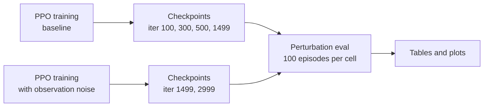

# autorl-demo


A simulated robot arm learns to pick up a cube and hold it at a target position. It learns by trial and error, with no human demonstrations, in under 30 minutes on one GPU. I then stress-tested the result with a heavier cube, slippery surfaces and noisy sensors to see where it breaks.

What I found:

- Learning is fast. In 27 minutes of training the arm goes from 0% to 100% of attempts ending within 2 cm of the target, 0.3 cm away on average.
- Physical changes break it suddenly. A cube 5 times heavier is fine (94%) and one 10 times heavier is not (3%). Half the friction is fine (99%) and a tenth is not (2%). Sensor noise wears it down steadily instead: 100, 97, 65, 28 and 1% as the noise goes from 0x to 1x, 2x, 3x and 5x.
- Training with noisy sensors is a tradeoff. With the same training time the arm becomes very imprecise (4% success without noise, against 100%). With twice the training it recovers to 63% and then beats the original under heavy noise (49% vs 28% at 3x, 15% vs 1% at 5x).

Videos of the final baseline policy (`model_1499.pt`):
[single-robot close-up (mp4)](logs/rsl_rl/franka_lift/2026-10-13_15-19-32_ppo_baseline/videos/play/closeup_1env_10s_clean.mp4) ·
[16 environments (mp4)](logs/rsl_rl/franka_lift/2026-10-13_15-19-32_ppo_baseline/videos/play/play_16env_10s.mp4)

## Why

This is a first step toward generating robot data and evaluations automatically with simulation and reinforcement learning, instead of by human teleoperation. A simulated policy can produce as many rollouts as I need and be scored under controlled perturbations with no person in the loop. Next I want to train vision policies and vision-language-action models (VLAs) on these rollouts.

## Pipeline



## Task setup

The task is Isaac Lab's `Isaac-Lift-Cube-Franka-v0`, unmodified. A Franka Panda picks up a cube and holds it at a goal position sampled once per 5-second episode (250 control steps at 50 Hz). An episode also ends if the cube falls below the table.

It is defined in Isaac Lab 2.0.2 in [`lift_env_cfg.py`](https://github.com/isaac-sim/IsaacLab/blob/v2.0.2/source/isaaclab_tasks/isaaclab_tasks/manager_based/manipulation/lift/lift_env_cfg.py) (observations, rewards, terminations) and [`config/franka/joint_pos_env_cfg.py`](https://github.com/isaac-sim/IsaacLab/blob/v2.0.2/source/isaaclab_tasks/isaaclab_tasks/manager_based/manipulation/lift/config/franka/joint_pos_env_cfg.py) (robot, actions, cube), with PPO settings in [`agents/rsl_rl_ppo_cfg.py`](https://github.com/isaac-sim/IsaacLab/blob/v2.0.2/source/isaaclab_tasks/isaaclab_tasks/manager_based/manipulation/lift/config/franka/agents/rsl_rl_ppo_cfg.py). Training uses 4096 parallel environments for 1500 iterations on one RTX 3090. The policy and value function are MLPs (256-128-64, ELU).

Observations (36 dimensions, state-based, no camera):

| Term | Dimensions | Contents |
|---|---|---|
| `joint_pos` | 9 | Joint positions relative to default (7 arm joints + 2 fingers) |
| `joint_vel` | 9 | Joint velocities (7 arm joints + 2 fingers) |
| `object_position` | 3 | Cube position in the robot base frame |
| `target_object_position` | 7 | Goal pose in the robot base frame (position + quaternion) |
| `actions` | 8 | The previous action |

Actions (8 dimensions):

| Part | Dimensions | Meaning |
|---|---|---|
| Arm | 7 | Joint position targets, as offsets from the default pose (scale 0.5) |
| Gripper | 1 | Binary: negative closes the fingers, otherwise they open (0.04 m) |

Rewards:

| Term | Weight | What it rewards |
|---|---|---|
| `reaching_object` | 1.0 | Gripper near the cube: `1 - tanh(distance / 0.1 m)` |
| `lifting_object` | 15.0 | Cube more than 4 cm above the table |
| `object_goal_tracking` | 16.0 | Cube near the goal while lifted: `1 - tanh(distance / 0.3 m)` |
| `object_goal_tracking_fine_grained` | 5.0 | The same, tighter: `1 - tanh(distance / 0.05 m)` |
| `action_rate` | -1e-4, raised to -1e-1 | Penalty on action changes between steps |
| `joint_vel` | -1e-4, raised to -1e-1 | Penalty on joint velocities |

A curriculum raises the two penalty weights after 10,000 environment steps.

## How I evaluate

I measure success at the end of each episode: the cube must finish within 2 cm of the goal. Each cell is 100 episodes (100 environments, one episode each) on `Isaac-Lift-Cube-Franka-Play-v0` with deterministic actions and the same seed, so all cells see the same goals.

With 100 episodes, a success rate near 50% carries roughly ±10 points of sampling uncertainty. The plots show 95% Wilson confidence intervals as error bars. The tables give plain percentages.

| Perturbation | What changes |
|---|---|
| Cube mass | Multiplier on the cube's mass and inertia |
| Friction | Multiplier on the friction of the cube and both gripper fingers (nominal 0.5) |
| Observation noise | Per-step Gaussian noise on joint positions (0.01 rad), joint velocities (0.1 rad/s) and cube position (1 cm), times the multiplier |
| Action noise | Per-step Gaussian noise on the policy's actions, arm and gripper |
| Spawn range | Multiplier on the cube's x/y spawn range (nominal x ±10 cm, y ±25 cm) |

The levels are set at the top of [`scripts/eval_lift.py`](scripts/eval_lift.py). The noise model is in [`scripts/obs_noise.py`](scripts/obs_noise.py).

## Results

### Training curve


The baseline reaches a mean episode reward of 152.2 after 1500 iterations. The noise-randomized run reaches 118.9 at iteration 1500 and 119.4 at iteration 3000. The dip around iteration 430 in both runs coincides with the curriculum raising the penalty weights.

I resumed the noise-randomized run from iteration 1500, which leaves two artifacts in its curve. The sharp drop at 1500 is the reward statistics restarting. The curriculum restarts too, so the reward rises to 140.7 at iteration 1640 and dips to 92.9 at iteration 1927 when the penalties are raised again. The plotted values are in [`results/training_curve.csv`](results/training_curve.csv).

### Success rate [%] (final distance < 2 cm), baseline policy

| Perturbation | Level | iter 100 | iter 300 | iter 500 | iter 1499 |
|---|---|---|---|---|---|
| None | none | 0 | 1 | 72 | 100 |
| Cube mass | x2 | 0 | 2 | 65 | 100 |
| | x3 | 0 | 2 | 58 | 97 |
| | x5 | 0 | 2 | 41 | 94 |
| | x10 | 0 | 1 | 0 | 3 |
| Friction (cube + fingers) | x0.5 | 0 | 4 | 72 | 99 |
| | x0.2 | 0 | 1 | 29 | 65 |
| | x0.1 | 0 | 0 | 0 | 2 |
| Observation noise | x1 | 0 | 1 | 54 | 97 |
| | x2 | 0 | 1 | 30 | 65 |
| | x3 | 0 | 0 | 8 | 28 |
| | x5 | 0 | 0 | 0 | 1 |
| Action noise | medium (std 0.1) | 0 | 1 | 68 | 99 |
| | strong (std 0.5) | 0 | 1 | 39 | 80 |
| Spawn range | medium (x1.5) | 0 | 3 | 65 | 99 |
| | strong (x2) | 0 | 0 | 60 | 83 |

Mean final distances are in [`results/eval_matrix.md`](results/eval_matrix.md) and all per-cell statistics in [`results/eval_matrix_cells.csv`](results/eval_matrix_cells.csv).

Precision arrives late. At iteration 300 the policy already lifts the cube (mean final distance 9 cm, down from 77 cm at iteration 100), but only 1% of episodes end within 2 cm. Iteration 500 reaches 72%.

Action noise and a wider spawn range are tolerated best: the final policy keeps 80% and 83% at the strong levels.

More training also buys robustness. Measured against its own unperturbed success rate (72%), the iteration-500 policy keeps a smaller share than the final policy under most perturbations. The exception is the doubled spawn range.

| Perturbation | iter 500 keeps | iter 1499 keeps |
|---|---|---|
| Cube mass x5 | 57% (41 of 72) | 94% |
| Friction x0.2 | 40% (29 of 72) | 65% |
| Observation noise x1 | 75% (54 of 72) | 97% |
| Observation noise x2 | 42% (30 of 72) | 65% |
| Action noise, strong | 54% (39 of 72) | 80% |
| Spawn range x2 | 83% (60 of 72) | 83% |


The x0 point on the noise plot and the x1 point on the mass plot are the shared unperturbed baseline.

## Baseline vs noise-randomized training

I trained a second policy with the same settings and one change: every environment draws an observation-noise multiplier uniformly from 0x to 3x at the start of each episode. I evaluated it after the same budget as the baseline (1500 iterations, 28 minutes) and again after resuming to 3000 iterations (21 more minutes), to test whether it was undertrained.


My take: noise training first made the policy robust but imprecise. Training longer recovered most of the precision, which leaves a clear tradeoff: worse at low noise, much better at high noise. The training reward barely changed between 1500 and 3000 iterations (118.9 to 119.4) while the evaluated precision improved a lot, which is why I evaluate separately instead of reading results off the training curve.

Success rate (final distance < 2 cm):

| Noise | Baseline, 1500 it | Noise-trained, 1500 it | Noise-trained, 3000 it |
|---|---|---|---|
| x0 | 100% | 4% | 63% |
| x1 | 97% | 5% | 69% |
| x2 | 65% | 15% | 56% |
| x3 | 28% | 18% | 49% |
| x5 | 1% | 16% | 15% |

Mean final distance:

| Noise | Baseline, 1500 it | Noise-trained, 1500 it | Noise-trained, 3000 it |
|---|---|---|---|
| x0 | 0.31 cm | 3.49 cm | 1.93 cm |
| x1 | 0.96 cm | 3.58 cm | 1.88 cm |
| x2 | 3.91 cm | 3.19 cm | 2.88 cm |
| x3 | 12.24 cm | 3.35 cm | 4.58 cm |
| x5 | 42.39 cm | 10.76 cm | 14.42 cm |

At 1500 iterations the noise-trained policy still lifts the cube in 98 to 99% of episodes up to 3x noise, but it stops 3.2 to 3.6 cm from the goal, just outside the 2 cm threshold. It beats the baseline only at 5x noise.

At 3000 iterations it is below the baseline at 0x and 1x, about level at 2x (56% vs 65% is close to the sampling error), and ahead at 3x and 5x. On mean final distance it is ahead from 2x upward.

Two caveats. I resumed the 3000-iteration policy from the 1500-iteration checkpoint, which restarts the penalty curriculum, so it is not identical to one uninterrupted run. And I did not train the baseline to 3000 iterations, so there is no equal-budget comparison.

Per-cell statistics: [`results/obs_noise_dr/`](results/obs_noise_dr/) (1500 iterations) and [`results/obs_noise_dr_3000/`](results/obs_noise_dr_3000/) (3000 iterations).

## Limitations

- The policy is state-based. It reads the exact cube position and joint state from the simulator, so nothing here says how a vision policy would behave.
- Everything is in simulation. The perturbations are stand-ins for sim-to-real gaps, not measurements of them.
- Each cell is 100 episodes, so small differences between cells are not meaningful.
- Each policy comes from one training run with a single seed.

## Next steps

- Vision student policy: distill the state-based policy into a student that sees camera images.
- VLA fine-tuning: use the same rollouts, with language task descriptions, to fine-tune a vision-language-action model.
- LLM-designed rewards: have a language model propose reward functions, scored automatically with this eval matrix.

## Reproducing

<details>
<summary>Setup</summary>

Tested with Isaac Lab 2.0.2 (git tag `v2.0.2`) on Isaac Sim 4.5.0 (binary install), Ubuntu 20.04, one NVIDIA RTX 3090, and a Python 3.10 conda environment with Isaac Lab installed (`./isaaclab.sh -i`), which provides `rsl-rl-lib` 2.3.3. Isaac Lab is not modified and is not part of this repository.

```bash
git clone git@github.com:Jason-lab1126/autorl-demo.git
cd autorl-demo
source env.sh        # activates the environment and pins everything to one GPU
```

</details>

<details>
<summary>What env.sh assumes</summary>

| What | Default | Change it in |
|---|---|---|
| Isaac Lab checkout | `~/IsaacLab` | `ISAACLAB_PATH` in `env.sh` |
| Isaac Sim install | `~/isaac-sim` | `ISAACSIM_PATH` in `env.sh` |
| Conda environment | `WL` | `conda activate` line in `env.sh` |
| GPU | index 0 | `DEMO_GPU=<index>` before sourcing |

</details>

<details>
<summary>Usage: train, evaluate, plot, record videos</summary>

Run everything from the repository root.

Train (PPO, headless, 4096 environments, 1500 iterations, a checkpoint every 50). Runs are written to `logs/rsl_rl/franka_lift/<timestamp>_<run_name>/`. Extra arguments go to Isaac Lab's `train.py`, for example `--num_envs 2048 --max_iterations 500`.

```bash
# baseline
./scripts/train_lift.sh --run_name ppo_baseline

# with observation noise (multiplier from 0x to OBS_NOISE_MAX, default 3, per episode)
TRAIN_PY=scripts/train_lift_obs_noise.py ./scripts/train_lift.sh --run_name ppo_obs_noise

# resume that run from iteration 1499 to 2999, in a new run directory
TRAIN_PY=scripts/train_lift_obs_noise.py ./scripts/train_lift.sh --run_name ppo_obs_noise_resume \
    --resume True --load_run 2026-10-13_16-36-46_ppo_obs_noise --checkpoint model_1499.pt --max_iterations 1501
```

Evaluate. The full matrix (4 checkpoints x 16 cells) takes about 5 minutes and writes `eval_matrix.md`, `eval_matrix.csv` and `eval_matrix_cells.csv`. Options: `--iters 500 1499`, `--perturbations obs_noise cube_mass`, `--num_envs 100`, `--threshold 0.02`, `--out_dir results`.

```bash
RUN=logs/rsl_rl/franka_lift/2026-10-13_15-19-32_ppo_baseline
python scripts/eval_lift.py --run_dir $RUN --headless --device cuda:0

# noise-trained policy, noise sweep only, at 1500 and 3000 iterations
NOISE_RUN=logs/rsl_rl/franka_lift/2026-10-13_16-36-46_ppo_obs_noise
python scripts/eval_lift.py --run_dir $NOISE_RUN --iters 1499 --perturbations obs_noise \
    --out_dir results/obs_noise_dr --headless --device cuda:0

NOISE_RUN_3000=logs/rsl_rl/franka_lift/2026-10-13_17-10-08_ppo_obs_noise_resume
python scripts/eval_lift.py --run_dir $NOISE_RUN_3000 --iters 2999 --perturbations obs_noise \
    --out_dir results/obs_noise_dr_3000 --headless --device cuda:0
```

Plot. None of these start the simulator. `plot_training.py` reads the TensorBoard event files, which are not committed.

```bash
# success vs. noise and vs. mass, one line per checkpoint
python scripts/plot_eval.py

# several policies on one sweep (@ITER picks a checkpoint other than --iter)
python scripts/plot_compare.py --policies "Baseline (1500 it)=results" "Noise-trained (1500 it)=results/obs_noise_dr" \
    "Noise-trained (3000 it)=results/obs_noise_dr_3000@2999" \
    --perturbation obs_noise --iter 1499 --out results/success_vs_obs_noise_compare.png

# training curves (+ joins a run with the run resumed from it)
python scripts/plot_training.py --runs "Baseline=$RUN" "Noise-trained (x0-x3)=$NOISE_RUN+$NOISE_RUN_3000" \
    --out results/training_curve.png
```

Record videos:

```bash
# Isaac Lab's stock play.py (wide view of all environments)
python scripts/play_lift.py --task Isaac-Lift-Cube-Franka-Play-v0 --num_envs 16 --headless --device cuda:0 \
    --video --video_length 500 --checkpoint $RUN/model_1499.pt

# close-up of one robot with a custom camera
python scripts/record_video.py --checkpoint $RUN/model_1499.pt --name closeup --no_markers \
    --eye 1.45 0.85 0.9 --lookat 0.3 0.0 0.35 --headless --device cuda:0
```

</details>

<details>
<summary>Repository layout</summary>

| Path | Contents |
|---|---|
| `env.sh` | Environment setup and GPU pinning |
| `scripts/` | Train, eval, plotting and video scripts |
| `results/` | Eval tables, plots and training-curve values |
| `results/obs_noise_dr/`, `results/obs_noise_dr_3000/` | Noise sweep of the noise-trained policy at 1500 and 3000 iterations |
| `media/` | GIF used in this README |
| `logs/rsl_rl/franka_lift/2026-10-13_15-19-32_ppo_baseline/` | Baseline run: checkpoints 100, 300, 500 and 1499, exported policy (`exported/policy.pt`, `policy.onnx`), configs, first single-checkpoint eval (`eval/`), two videos |
| `logs/rsl_rl/franka_lift/2026-10-13_16-36-46_ppo_obs_noise/` | Noise-randomized run: the same four checkpoints and configs, including `params/obs_noise.json` |
| `logs/rsl_rl/franka_lift/2026-10-13_17-10-08_ppo_obs_noise_resume/` | That run resumed to 3000 iterations: `model_2999.pt` and configs |

</details>

<details>
<summary>Note on the play.py alias</summary>

`play_lift.py` runs Isaac Lab's `play.py` unmodified. It only adds a one-line alias, because Isaac Lab 2.0.2's `play.py` expects an attribute that `rsl-rl-lib` 2.3.3 renamed.

</details>
