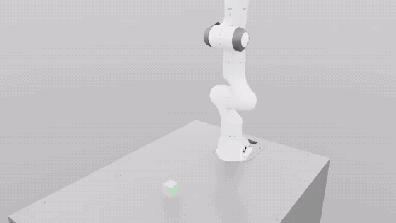

# autorl-demo

Train a PPO policy for the Franka Panda lift-cube task in Isaac Lab, then measure how robust it is: an end-of-episode success metric evaluated across checkpoints and physical/sensing perturbations.

**Why.** This is a first step toward using simulation and reinforcement learning to generate robot data and evaluations automatically, instead of collecting them by human teleoperation. A policy trained in simulation can produce as many rollouts as needed and can be scored under controlled perturbations without a person in the loop. The next step is to train vision policies and vision-language-action models (VLAs) on these rollouts.



Videos of the final baseline policy (`model_1499.pt`):
[single-robot close-up (mp4)](logs/rsl_rl/franka_lift/2026-10-13_15-19-32_ppo_baseline/videos/play/closeup_1env_10s_clean.mp4) ·
[16 environments (mp4)](logs/rsl_rl/franka_lift/2026-10-13_15-19-32_ppo_baseline/videos/play/play_16env_10s.mp4)

## Key findings

- **The task is solved in under half an hour.** 1500 PPO iterations (4096 envs, 27 minutes on one RTX 3090) take the policy from 0% to 100% success, with the cube ending 0.3 cm from its goal on average.
- **Robustness has cliffs.** The final policy is almost unaffected up to 5x cube mass (94%) and collapses at 10x (3%); friction costs nothing at 0.5x (99%) and nearly everything at 0.1x (2%). Observation noise degrades it smoothly: 100 → 97 → 65 → 28 → 1% at 0x, 1x, 2x, 3x, 5x.
- **Training with observation noise trades precision for robustness, and needs more training.** A policy trained with randomized noise (0x–3x) for the same 1500 iterations is far less precise than the baseline: only 4% of noise-free episodes end within 2 cm, against 100%. Doubling its training to 3000 iterations raises that to 63%, still below the baseline, and it then beats the baseline under strong noise (49% vs 28% at 3x, 15% vs 1% at 5x).

More findings are under [Results](#results).

## Task setup

The task is Isaac Lab's `Isaac-Lift-Cube-Franka-v0`, unmodified: a Franka Panda must pick up a cube from a table and hold it at a commanded goal position, which is sampled once per 5-second episode (250 control steps at 50 Hz). It is defined in Isaac Lab 2.0.2 in [`lift_env_cfg.py`](https://github.com/isaac-sim/IsaacLab/blob/v2.0.2/source/isaaclab_tasks/isaaclab_tasks/manager_based/manipulation/lift/lift_env_cfg.py) (observations, rewards, terminations) and [`config/franka/joint_pos_env_cfg.py`](https://github.com/isaac-sim/IsaacLab/blob/v2.0.2/source/isaaclab_tasks/isaaclab_tasks/manager_based/manipulation/lift/config/franka/joint_pos_env_cfg.py) (robot, actions, cube). The PPO settings are in [`agents/rsl_rl_ppo_cfg.py`](https://github.com/isaac-sim/IsaacLab/blob/v2.0.2/source/isaaclab_tasks/isaaclab_tasks/manager_based/manipulation/lift/config/franka/agents/rsl_rl_ppo_cfg.py).

### Observations (36 dimensions, state-based)

| Term | Dimensions | Contents |
|---|---|---|
| `joint_pos` | 9 | Joint positions relative to the default pose (7 arm joints + 2 fingers) |
| `joint_vel` | 9 | Joint velocities relative to the default (7 arm joints + 2 fingers) |
| `object_position` | 3 | Cube position in the robot base frame |
| `target_object_position` | 7 | Commanded goal pose in the robot base frame (position + quaternion) |
| `actions` | 8 | The previous action |

The policy and the value function are MLPs (256-128-64, ELU) on the same 36-dimensional vector. There are no camera inputs.

### Actions (8 dimensions)

| Part | Dimensions | Meaning |
|---|---|---|
| Arm | 7 | Joint position targets for the 7 arm joints, as offsets from the default pose (scale 0.5) |
| Gripper | 1 | Binary: a negative value closes the fingers, otherwise they open (0.04 m) |

### Rewards

| Term | Weight | What it rewards |
|---|---|---|
| `reaching_object` | 1.0 | Gripper close to the cube: `1 - tanh(distance / 0.1 m)` |
| `lifting_object` | 15.0 | Cube more than 4 cm above the table |
| `object_goal_tracking` | 16.0 | Cube close to the goal while lifted: `1 - tanh(distance / 0.3 m)` |
| `object_goal_tracking_fine_grained` | 5.0 | The same with a tighter scale: `1 - tanh(distance / 0.05 m)` |
| `action_rate` | -1e-4, raised to -1e-1 | Penalty on the change in action between steps |
| `joint_vel` | -1e-4, raised to -1e-1 | Penalty on joint velocities |

The two penalty weights are increased by the task's curriculum after 10,000 environment steps. An episode ends after 5 seconds or if the cube falls below the table.

## Results

Success is measured at the **end** of each episode: the cube must finish within 2 cm of the commanded goal position. Each cell is 100 episodes (100 environments, one episode each) on `Isaac-Lift-Cube-Franka-Play-v0` with deterministic policy actions, and every cell is reset with the same seed so all cells see the same goals. With 100 episodes per cell, differences of a few points are within sampling error.

### Training curve


The baseline reaches a mean episode reward of 152.2 after 1500 iterations. The noise-randomized run reaches 118.9 at iteration 1500 and 119.4 at iteration 3000. The dip around iteration 430 in both runs coincides with the curriculum raising the two penalty weights.

The noise-randomized run was trained to 1500 iterations and later resumed to 3000, which leaves two artifacts in its curve: the sharp drop at iteration 1500 is the reward statistics restarting, and because the curriculum also restarts, the penalties are weak again for a while (reward up to 140.7 at iteration 1640) before being raised a second time (dip to 92.9 at iteration 1927). The plotted values are in [`results/training_curve.csv`](results/training_curve.csv).

### Success rate [%] (final distance < 2 cm), baseline policy

| Perturbation | Level | iter 100 | iter 300 | iter 500 | iter 1499 |
|---|---|---|---|---|---|
| None | – | 0 | 1 | 72 | 100 |
| Cube mass | x2 | 0 | 2 | 65 | 100 |
| | x3 | 0 | 2 | 58 | 97 |
| | x5 | 0 | 2 | 41 | 94 |
| | x10 | 0 | 1 | 0 | 3 |
| Friction (cube + fingers) | x0.5 | 0 | 4 | 72 | 99 |
| | x0.2 | 0 | 1 | 29 | 65 |
| | x0.1 | 0 | 0 | 0 | 2 |
| Observation noise | x1 | 0 | 1 | 54 | 97 |
| | x2 | 0 | 1 | 30 | 65 |
| | x3 | 0 | 0 | 8 | 28 |
| | x5 | 0 | 0 | 0 | 1 |
| Action noise | medium (std 0.1) | 0 | 1 | 68 | 99 |
| | strong (std 0.5) | 0 | 1 | 39 | 80 |
| Spawn range | medium (x1.5) | 0 | 3 | 65 | 99 |
| | strong (x2) | 0 | 0 | 60 | 83 |

The mean final distance per cell is in [`results/eval_matrix.md`](results/eval_matrix.md); all per-cell statistics are in [`results/eval_matrix_cells.csv`](results/eval_matrix_cells.csv).

### More findings

- **Precision arrives late.** At iteration 300 the policy already lifts the cube (mean final distance 9 cm, down from 77 cm at iteration 100) but only 1% of episodes end within 2 cm. Iteration 500 reaches 72%, the final policy 100%.
- **Cube mass has a cliff.** The final policy is almost unaffected up to 5x mass (94%) and collapses at 10x (3%).
- **Friction matters once it is low enough.** Halving cube and finger friction costs nothing (99%); at 0.2x success drops to 65% and at 0.1x to 2%.
- **Observation noise degrades smoothly.** 100 → 97 → 65 → 28 → 1% at 0x, 1x, 2x, 3x, 5x noise.
- **Action noise and a wider spawn range are tolerated best.** The final policy keeps 80% with strong action noise and 83% with a doubled spawn range.
- **More training buys robustness, not just nominal success.** Measured against its own unperturbed success rate (72%), the iteration-500 policy keeps a smaller share than the final policy (100%) under most perturbations:

  | Perturbation | iter 500 keeps | iter 1499 keeps |
  |---|---|---|
  | Cube mass x5 | 57% (41 of 72) | 94% |
  | Friction x0.2 | 40% (29 of 72) | 65% |
  | Observation noise x1 | 75% (54 of 72) | 97% |
  | Observation noise x2 | 42% (30 of 72) | 65% |
  | Action noise, strong | 54% (39 of 72) | 80% |
  | Spawn range x2 | 83% (60 of 72) | 83% |

  The exception is the doubled spawn range, where both keep 83%.

### Success vs. observation noise


### Success vs. cube mass


The x0 point on the noise plot and the x1 point on the mass plot are the shared unperturbed baseline.

### Perturbations

| Perturbation | What changes |
|---|---|
| Cube mass | Multiplier on the cube's mass and inertia |
| Friction | Multiplier on the static and dynamic friction of the cube and both gripper fingers (nominal 0.5) |
| Observation noise | Per-step Gaussian noise on joint positions (0.01 rad), joint velocities (0.1 rad/s) and cube position (1 cm), times the multiplier; the goal and last-action entries stay clean |
| Action noise | Per-step Gaussian noise on the raw policy actions, arm and gripper |
| Spawn range | Multiplier on the cube's x/y spawn range (nominal x ±10 cm, y ±25 cm) |

The levels are defined in one table at the top of [`scripts/eval_lift.py`](scripts/eval_lift.py); the noise model is in [`scripts/obs_noise.py`](scripts/obs_noise.py).

## Baseline vs noise-randomized training

A second policy was trained with the same task and PPO settings, with one change: every environment draws an observation-noise multiplier uniformly from 0x to 3x at the start of each episode, using the same noise model as the eval sweep. It was evaluated twice: after the same budget as the baseline (1500 iterations, 28 minutes), and after resuming training to 3000 iterations (21 more minutes) to test whether it was simply undertrained.


**Takeaway: the noise-trained policy was undertrained, but more training only closes part of the gap. Doubling its training lifts noise-free success from 4% to 63% (baseline 100%), and it then beats the baseline at 3x and 5x noise.**

Success rate (final distance < 2 cm):

| Noise | Baseline, 1500 it | Noise-trained, 1500 it | Noise-trained, 3000 it |
|---|---|---|---|
| x0 | 100% | 4% | 63% |
| x1 | 97% | 5% | 69% |
| x2 | 65% | 15% | 56% |
| x3 | 28% | 18% | 49% |
| x5 | 1% | 16% | 15% |

Mean final distance:

| Noise | Baseline, 1500 it | Noise-trained, 1500 it | Noise-trained, 3000 it |
|---|---|---|---|
| x0 | 0.31 cm | 3.49 cm | 1.93 cm |
| x1 | 0.96 cm | 3.58 cm | 1.88 cm |
| x2 | 3.91 cm | 3.19 cm | 2.88 cm |
| x3 | 12.24 cm | 3.35 cm | 4.58 cm |
| x5 | 42.39 cm | 10.76 cm | 14.42 cm |

- **At 1500 iterations the noise-trained policy is robust but imprecise.** It lifts the cube in 98–99% of episodes up to 3x noise and its final error stays flat at 3.2–3.6 cm, but that is just outside the 2 cm threshold, so almost every episode counts as a failure. It beats the baseline on success rate only at 5x noise.
- **At 3000 iterations it is much more precise.** Without noise its mean final error falls from 3.49 cm to 1.93 cm and success rises from 4% to 63%. It is still well short of the baseline's 0.31 cm and 100%.
- **The crossover moves to moderate noise.** The 3000-iteration policy is below the baseline at 0x and 1x, about level at 2x (56% vs 65%, close to the sampling error of 100 episodes), and ahead at 3x (49% vs 28%) and 5x (15% vs 1%). On mean final distance it is ahead from 2x upward.
- **The training reward does not show the improvement.** It is 118.9 at iteration 1500 and 119.4 at iteration 3000, although the evaluated precision improved a lot. Training reward is measured with noisy observations and exploration noise, so it is a poor proxy here.

Two caveats on this comparison:

- The 3000-iteration policy was **resumed** from the 1500-iteration checkpoint, not trained in one run. Resuming restarts the task's penalty curriculum, so it is not identical to an uninterrupted 3000-iteration run.
- The baseline was not trained to 3000 iterations, so there is no equal-budget comparison at 3000. The baseline is already at 100% without noise; whether longer training changes its robustness has not been tested.

The per-cell statistics are in [`results/obs_noise_dr/`](results/obs_noise_dr/) (1500 iterations) and [`results/obs_noise_dr_3000/`](results/obs_noise_dr_3000/) (3000 iterations).

## Limitations

- **State-based policy.** The policy reads the exact cube position and joint state from the simulator. It has no camera input, so nothing here says how a vision policy would behave.
- **Simulation only.** Nothing has been run on a real robot. The perturbations are stand-ins for sim-to-real gaps, not measurements of them.
- **100 episodes per cell.** A success rate near 50% carries roughly ±10 points of sampling uncertainty, so small differences between cells are not meaningful.
- **One training run per policy.** Each policy comes from a single seed, so run-to-run variation is not measured.

## Next steps

- **Vision student policy.** Distill the state-based policy into a student that sees camera images, using the state-based policy's rollouts as supervision.
- **VLA fine-tuning.** Use the same rollouts, with language task descriptions, to fine-tune a vision-language-action model.
- **LLM-designed rewards.** Have a language model propose and iterate on reward functions, scored automatically with this eval matrix.

## Setup

Tested with:

- Isaac Lab 2.0.2 (git tag `v2.0.2`) on Isaac Sim 4.5.0 (binary install), Ubuntu 20.04, one NVIDIA RTX 3090
- Python 3.10 conda environment with Isaac Lab installed (`./isaaclab.sh -i`), which provides `rsl-rl-lib` 2.3.3

Isaac Lab itself is not modified and is not part of this repository. `env.sh` assumes:

| What | Default | Change it in |
|---|---|---|
| Isaac Lab checkout | `~/IsaacLab` | `ISAACLAB_PATH` in `env.sh` |
| Isaac Sim install | `~/isaac-sim` | `ISAACSIM_PATH` in `env.sh` |
| Conda environment | `WL` | `conda activate` line in `env.sh` |
| GPU | index 0 | `DEMO_GPU=<index>` before sourcing |

```bash
git clone git@github.com:Jason-lab1126/autorl-demo.git
cd autorl-demo
source env.sh        # activates the environment and pins everything to one GPU
```

## Usage

Run everything from the repository root.

### Train

```bash
./scripts/train_lift.sh --run_name ppo_baseline
```

PPO (rsl_rl) on `Isaac-Lift-Cube-Franka-v0`, headless, 4096 environments, 1500 iterations, a checkpoint every 50 iterations. The run is written to `logs/rsl_rl/franka_lift/<timestamp>_<run_name>/`. Extra arguments are passed to Isaac Lab's `train.py` (for example `--num_envs 2048 --max_iterations 500`).

To train with observation-noise randomization (multiplier drawn from 0x to `OBS_NOISE_MAX`, default 3, per episode):

```bash
TRAIN_PY=scripts/train_lift_obs_noise.py ./scripts/train_lift.sh --run_name ppo_obs_noise
```

To resume that run from iteration 1499 up to iteration 2999 (written to a new run directory):

```bash
TRAIN_PY=scripts/train_lift_obs_noise.py ./scripts/train_lift.sh --run_name ppo_obs_noise_resume \
    --resume True --load_run 2026-10-13_16-36-46_ppo_obs_noise --checkpoint model_1499.pt --max_iterations 1501
```

### Evaluate

```bash
RUN=logs/rsl_rl/franka_lift/2026-10-13_15-19-32_ppo_baseline
python scripts/eval_lift.py --run_dir $RUN --headless --device cuda:0
```

Runs the full matrix (4 checkpoints x 16 cells, about 5 minutes) in a single simulator instance and writes `eval_matrix.md`, `eval_matrix.csv` and `eval_matrix_cells.csv` into `results/`. Useful options: `--iters 500 1499`, `--perturbations obs_noise cube_mass`, `--num_envs 100`, `--threshold 0.02`, `--out_dir results`.

The noise-trained policy was evaluated on the noise sweep only, at 1500 and 3000 iterations:

```bash
NOISE_RUN=logs/rsl_rl/franka_lift/2026-10-13_16-36-46_ppo_obs_noise
python scripts/eval_lift.py --run_dir $NOISE_RUN --iters 1499 --perturbations obs_noise \
    --out_dir results/obs_noise_dr --headless --device cuda:0

NOISE_RUN_3000=logs/rsl_rl/franka_lift/2026-10-13_17-10-08_ppo_obs_noise_resume
python scripts/eval_lift.py --run_dir $NOISE_RUN_3000 --iters 2999 --perturbations obs_noise \
    --out_dir results/obs_noise_dr_3000 --headless --device cuda:0
```

### Plot

```bash
# success vs. noise and vs. mass, one line per checkpoint
python scripts/plot_eval.py

# several policies on one sweep (@ITER picks a checkpoint other than --iter)
python scripts/plot_compare.py --policies "Baseline (1500 it)=results" "Noise-trained (1500 it)=results/obs_noise_dr" \
    "Noise-trained (3000 it)=results/obs_noise_dr_3000@2999" \
    --perturbation obs_noise --iter 1499 --out results/success_vs_obs_noise_compare.png

# training curves from the TensorBoard logs (+ joins a run with the run resumed from it)
python scripts/plot_training.py --runs "Baseline=$RUN" "Noise-trained (x0-x3)=$NOISE_RUN+$NOISE_RUN_3000" \
    --out results/training_curve.png
```

None of these start the simulator. `plot_training.py` reads the runs' TensorBoard event files, which are not committed; its output values are in `results/training_curve.csv`.

### Videos

```bash
# Isaac Lab's stock play.py (wide view of all environments)
python scripts/play_lift.py --task Isaac-Lift-Cube-Franka-Play-v0 --num_envs 16 --headless --device cuda:0 \
    --video --video_length 500 --checkpoint $RUN/model_1499.pt

# close-up of one robot with a custom camera
python scripts/record_video.py --checkpoint $RUN/model_1499.pt --name closeup --no_markers \
    --eye 1.45 0.85 0.9 --lookat 0.3 0.0 0.35 --headless --device cuda:0
```

`play_lift.py` runs Isaac Lab's `play.py` unmodified; it only adds a one-line alias because Isaac Lab 2.0.2's `play.py` expects an attribute that `rsl-rl-lib` 2.3.3 renamed.

## Repository layout

| Path | Contents |
|---|---|
| `env.sh` | Environment setup and GPU pinning |
| `scripts/` | Train, eval matrix, plotting and video scripts |
| `results/` | Eval tables (markdown, CSV), plots and the training-curve values |
| `results/obs_noise_dr/`, `results/obs_noise_dr_3000/` | Noise-sweep eval of the noise-trained policy at 1500 and 3000 iterations |
| `media/` | GIF preview used in this README |
| `logs/rsl_rl/franka_lift/2026-10-13_15-19-32_ppo_baseline/` | The baseline training run: checkpoints for iterations 100, 300, 500 and 1499, the exported policy (`exported/policy.pt`, `policy.onnx`), configs (`params/`), the first single-checkpoint eval (`eval/`) and the two videos |
| `logs/rsl_rl/franka_lift/2026-10-13_16-36-46_ppo_obs_noise/` | The noise-randomized training run: the same four checkpoints and configs, including `params/obs_noise.json` |
| `logs/rsl_rl/franka_lift/2026-10-13_17-10-08_ppo_obs_noise_resume/` | That run resumed to 3000 iterations: the final checkpoint (`model_2999.pt`) and configs |
