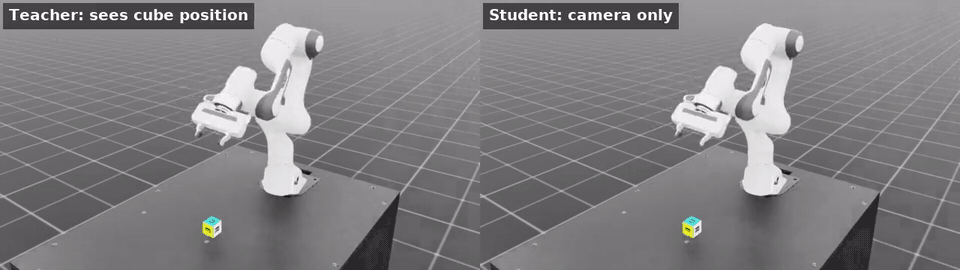
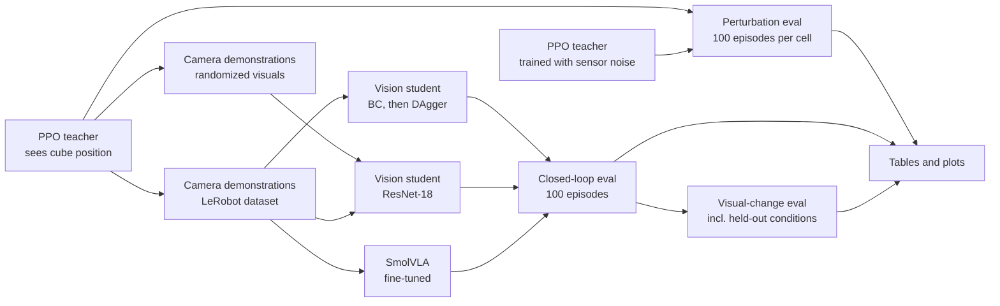
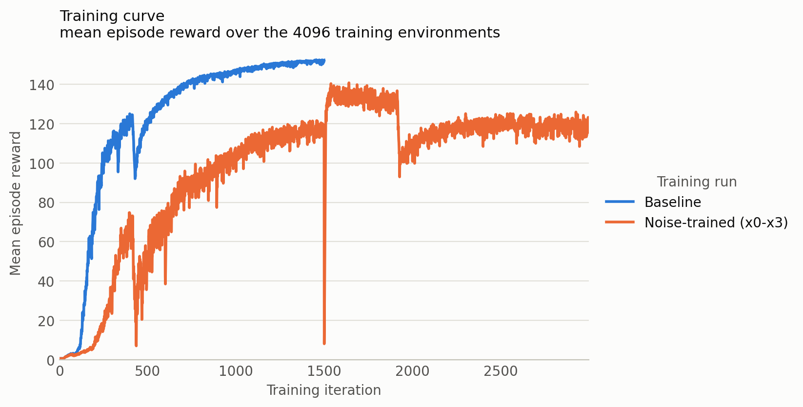
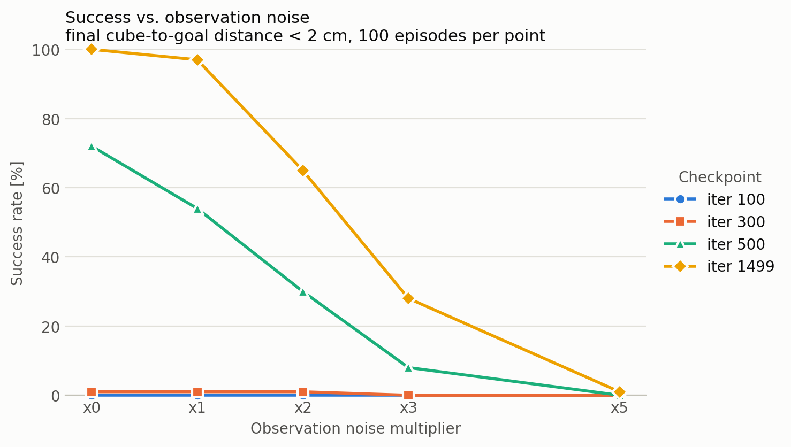
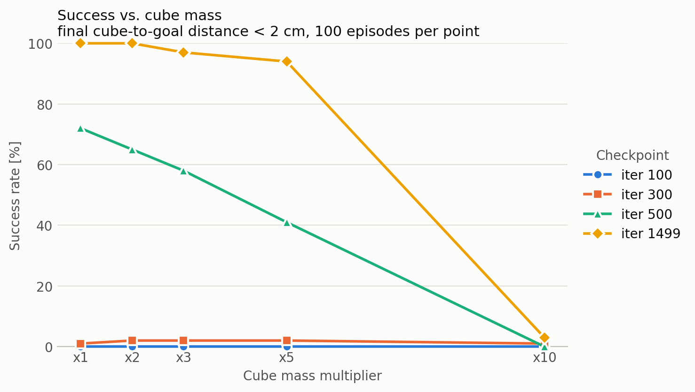
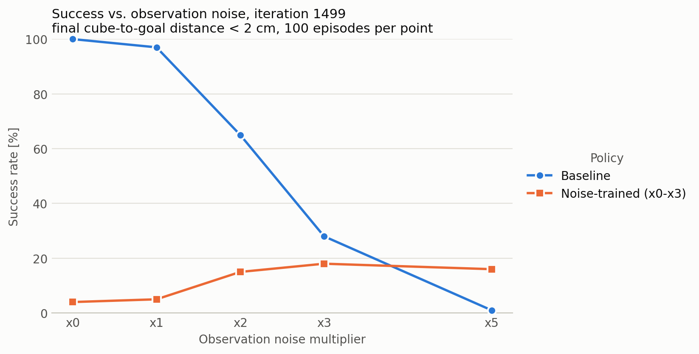
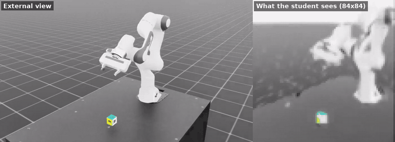
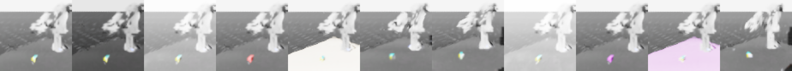
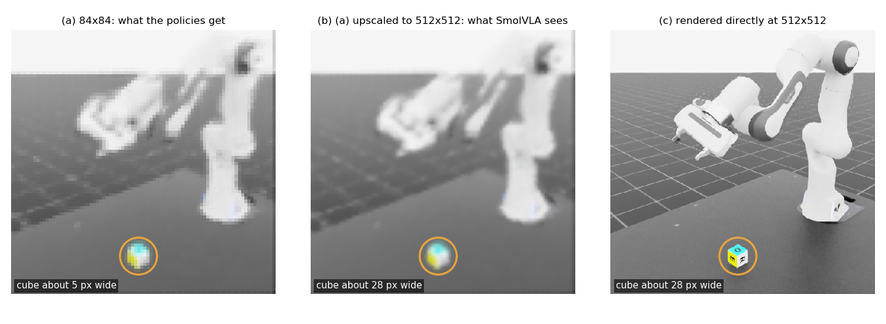
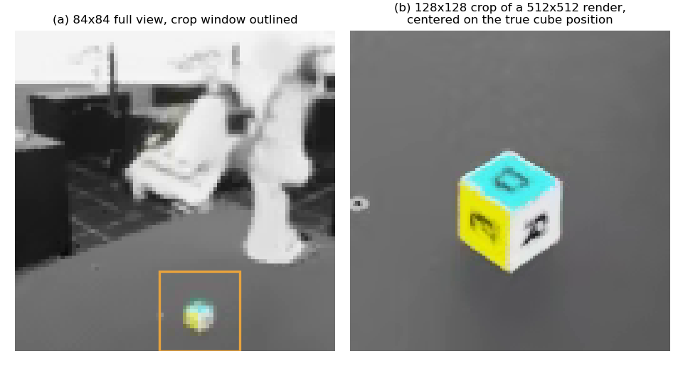

# From an RL teacher to a camera-only student: Franka cube lifting in Isaac Lab



A simulated robot arm learns to pick up a cube and hold it at a target, by trial and error, in under 30 minutes. I tested where that policy breaks. Then I trained a second policy that only gets a camera image, by having it imitate the first one.

What I found:

- The arm learns fast. In 27 minutes of training it goes from 0% to 100% of attempts ending within 2 cm of the target, 0.3 cm away on average.
- It breaks at specific points. A cube 5 times heavier is fine (94%) and one 10 times heavier is not (3%). Sensor noise wears it down steadily: 100, 97, 65, 28 and 1% as the noise goes from 0x to 1x, 2x, 3x and 5x.
- A camera-only student can copy it. With 500 demonstrations it succeeds 44% of the time. With 1,250 it reaches 93%, against 100% for the teacher that is told where the cube is.
- The camera-only student broke under any visual change: brighter light, a new table color or a camera moved 5 cm took it to 0%. Training on randomized visuals with a pretrained ResNet-18 recovered most of it, 53 to 81% under light and color changes, including ones never seen in training. Camera moves are still the weak point (16 to 46%).
- A fine-tuned SmolVLA, a pretrained vision-language-action model, did much worse than the small CNN on the same data: 15% against 93%. Training its vision encoder as well raised that to 26%. Giving it a sharp close-up of the cube as a second image did not help (15%), so not seeing the cube clearly is not the main cause.

In the clip above both policies start from the same cube position and goal. The teacher ends 0.06 cm from the goal and the student 1.46 cm.

## Why

This is a first step toward generating robot training data with simulation and reinforcement learning instead of human teleoperation. A simulated policy can produce as many demonstrations as I need and be scored with no person in the loop.

## What I built

The lift task and the PPO training are stock Isaac Lab. I did not design the task, the rewards or the training algorithm. I built the evaluation (end-of-episode success under perturbations), the noise-training study, and the student pipeline (camera data, LeRobot export, behavior cloning, DAgger, closed-loop evaluation), the visual robustness eval, the visual randomization study, and the SmolVLA fine-tuning with a policy server so it runs in the same closed-loop eval.

## Pipeline



## Part 1: the teacher

### Training

The task is Isaac Lab's `Isaac-Lift-Cube-Franka-v0`: a Franka Panda picks up a cube and holds it at a goal position for a 5-second episode. The teacher sees the cube position directly (inputs and outputs are under "Task details" at the end). I trained it with PPO for 1500 iterations on 4096 parallel environments, 27 minutes on one RTX 3090.



The baseline reaches a mean episode reward of 152.2. The second line is the noise-trained policy below.

### How I evaluate

Success means the cube ends the episode within 2 cm of the goal. Each cell is 100 episodes with the same seed, and I perturb one thing at a time.

<details>
<summary>Evaluation details</summary>

Every cell sees the same goals. With 100 episodes, a rate near 50% carries about ±10 points of sampling uncertainty. The plots show 95% Wilson intervals.

The perturbations: cube mass, friction of the cube and fingers, noise on the observations (1x is 0.01 rad on joint positions, 0.1 rad/s on joint velocities, 1 cm on cube position), noise on the actions, and the size of the cube's spawn area.

</details>

### Robustness

The final policy handles a cube up to 5 times heavier (94%) but fails at 10 times (3%), and friction has the same kind of cliff: 99% at half friction, 65% at 0.2x, 2% at a tenth. Sensor noise wears it down steadily instead, while action noise and a wider spawn area are tolerated best (80% and 83% at the strong levels).





<details>
<summary>Full robustness table (16 rows)</summary>

Success rate [%] by training checkpoint. Iteration 100 is 0% in every row.

| Perturbation | Level | iter 300 | iter 500 | iter 1499 |
|---|---|---|---|---|
| None | none | 1 | 72 | 100 |
| Cube mass | x2 | 2 | 65 | 100 |
| | x3 | 2 | 58 | 97 |
| | x5 | 2 | 41 | 94 |
| | x10 | 1 | 0 | 3 |
| Friction (cube + fingers) | x0.5 | 4 | 72 | 99 |
| | x0.2 | 1 | 29 | 65 |
| | x0.1 | 0 | 0 | 2 |
| Observation noise | x1 | 1 | 54 | 97 |
| | x2 | 1 | 30 | 65 |
| | x3 | 0 | 8 | 28 |
| | x5 | 0 | 0 | 1 |
| Action noise | medium (std 0.1) | 1 | 68 | 99 |
| | strong (std 0.5) | 1 | 39 | 80 |
| Spawn range | medium (x1.5) | 3 | 65 | 99 |
| | strong (x2) | 0 | 60 | 83 |

More training buys robustness as well as precision: at 5x mass the iteration-500 policy keeps 57% of its own unperturbed success (41 of 72), and the final policy keeps 94%.

Precision arrives late. At iteration 300 the policy already lifts the cube (9 cm from the goal on average, down from 77 cm at iteration 100), but only 1% of episodes end within 2 cm.

Mean final distances are in [`results/eval_matrix.md`](results/eval_matrix.md) and all per-cell statistics in [`results/eval_matrix_cells.csv`](results/eval_matrix_cells.csv).

</details>

### Training with noise is a tradeoff

I trained a second teacher with observation noise drawn from 0x to 3x each episode, and evaluated it after 1500 iterations (28 minutes) and again after resuming to 3000 (21 more minutes).



Noise training first made the policy robust but imprecise: it stopped 3.2 to 3.6 cm from the goal whatever the noise level. Training longer recovered most of the precision. What is left is a clear tradeoff: worse than the baseline at low noise, much better at high noise.

<details>
<summary>Noise-training table and caveats</summary>

Success rate, with mean final distance in brackets:

| Noise | Baseline, 1500 it | Noise-trained, 1500 it | Noise-trained, 3000 it |
|---|---|---|---|
| x0 | 100% (0.31 cm) | 4% (3.49 cm) | 63% (1.93 cm) |
| x1 | 97% (0.96 cm) | 5% (3.58 cm) | 69% (1.88 cm) |
| x2 | 65% (3.91 cm) | 15% (3.19 cm) | 56% (2.88 cm) |
| x3 | 28% (12.24 cm) | 18% (3.35 cm) | 49% (4.58 cm) |
| x5 | 1% (42.39 cm) | 16% (10.76 cm) | 15% (14.42 cm) |

The training reward barely moved between 1500 and 3000 iterations (118.9 to 119.4) while the evaluated precision improved a lot. That is why I evaluate separately instead of reading results off the training curve.

Two caveats. I resumed the 3000-iteration policy from a checkpoint, which restarts the task's penalty curriculum. And I did not train the baseline to 3000 iterations.

</details>

## Part 2: the student



The right panel is everything the student sees of the scene. In this clip the first episode ends 1.46 cm from the goal. The second ends 2.40 cm away, just outside the 2 cm threshold.

### What the student gets

- One 84x84 RGB image from a fixed camera.
- 21 numbers: 9 joint positions, 9 joint velocities and the 3-number goal position.
- Not the cube position. It has to find the cube in the image.

It outputs the same 8-number action as the teacher. The model is a small CNN for the image and an MLP for the numbers, trained with a mean squared error loss on the teacher's action.

### Data

I rolled out the teacher with a little noise on its actions (std 0.1) so it visits more states, and recorded the action it wanted to take as the label.

<details>
<summary>Dataset details</summary>

The first set is 500 episodes (125,000 frames), split 450/50 by episode.

The same 500 episodes are exported as a LeRobot dataset (format v3.0) with the instruction "pick up the cube and move it to the target", written and re-loaded with LeRobot's own code. The datasets are not in this repository.

</details>

### Results

Closed-loop, 100 episodes each, same seed and metric as the teacher's eval:

| Policy | Training episodes | Success at 2 cm | Mean final distance | Median final distance | Cube lifted |
|---|---|---|---|---|---|
| Teacher (sees cube position) | - | 100% | 0.32 cm | 0.30 cm | 100% |
| BC 500 | 500 | 44% | 8.79 cm | 2.26 cm | 85% |
| BC + more teacher data | 1250 | 93% | 2.27 cm | 0.85 cm | 97% |
| BC + DAgger round 1 | 750 | 55% | 8.22 cm | 1.75 cm | 84% |
| BC + DAgger round 2 | 1000 | 72% | 8.39 cm | 1.25 cm | 83% |
| BC + DAgger round 3 | 1250 | 88% | 3.42 cm | 0.92 cm | 95% |

BC is behavior cloning on teacher rollouts. More teacher data did about as well as DAgger at the same number of episodes (93% against 88%).

<details>
<summary>DAgger, failure cases and notes</summary>

The teacher's 0.32 cm here and 0.31 cm in Part 1 come from two separate runs of the same 100 episodes, which do not reproduce to the last digit. I round it to 0.3 cm in the summary.

BC is behavior cloning on teacher rollouts. In each DAgger round the current student drives for 250 episodes, the teacher labels what it should have done, and a new student is trained on everything so far. The "more teacher data" row adds 750 teacher episodes instead, so both end at 1,250.

I expected DAgger to win. At matched data, plain BC on noise-injected teacher data did about as well: 93% against 88%, one training seed each, within the sampling error of 100 episodes. My guess is that the action noise already makes the teacher visit and correct the off-course states DAgger is meant to add.

The best student still fails 7 of 100 episodes. In 3 it never grasps the cube, and in 4 it lifts it but stops 2.3 to 4.4 cm from the goal. [Here is one of the missed grasps](media/student_failure.mp4): the arm reaches past the cube and ends 44.5 cm from the goal.

</details>

More clips: [student close-up (mp4)](media/student_closeup_10s.mp4) · [teacher close-up (mp4)](logs/rsl_rl/franka_lift/2026-10-13_15-19-32_ppo_baseline/videos/play/closeup_1env_10s_clean.mp4) · [teacher, 16 environments (mp4)](logs/rsl_rl/franka_lift/2026-10-13_15-19-32_ppo_baseline/videos/play/play_16env_10s.mp4). Full table: [`results/student_comparison.md`](results/student_comparison.md).

### What the student depends on

I re-ran the best student and the teacher with changes that only affect what the camera sees. Each cell is 100 episodes. Student cells show success, with mean final distance in brackets.

| Change | Held out | Teacher | Student, fixed scene | Randomized, small CNN | Randomized, ResNet-18 |
|---|---|---|---|---|---|
| None | no | 100% | 90% (3.34 cm) | 1% (40.88 cm) | 86% (2.56 cm) |
| Light intensity x0.5 | no | 100% | 53% (7.72 cm) | 0% (40.98 cm) | 78% (5.34 cm) |
| Light intensity x2 | no | 100% | 0% (41.15 cm) | 0% (41.12 cm) | 81% (5.91 cm) |
| Cube color: flat red | no | 100% | 20% (28.80 cm) | 2% (40.61 cm) | 62% (8.06 cm) |
| Table color: light wood | no | 100% | 0% (41.57 cm) | 1% (40.36 cm) | 63% (13.42 cm) |
| Camera moved 5 cm sideways | no | 100% | 0% (43.09 cm) | 1% (40.29 cm) | 46% (19.57 cm) |
| Camera moved 10 cm sideways | no | 100% | 0% (40.23 cm) | 2% (40.82 cm) | 22% (32.28 cm) |
| Light intensity x3 | yes | 100% | 0% (41.40 cm) | 1% (41.14 cm) | 79% (8.17 cm) |
| Cube color: purple | yes | 100% | 0% (40.49 cm) | 1% (40.64 cm) | 62% (8.37 cm) |
| Table color: purple | yes | 100% | 0% (41.55 cm) | 0% (41.87 cm) | 53% (15.70 cm) |
| Camera moved 12 cm sideways | yes | 100% | 0% (40.56 cm) | 0% (40.86 cm) | 16% (34.43 cm) |



The teacher ignores all of these, because it never looks at the image. The first student depends on them completely. A brighter light, a lighter table or a camera moved by 5 cm takes it from 90% to 0%, and it mostly stops lifting the cube at all. A camera-based policy trained on one fixed scene is not ready for a real robot.

To fix this I collected new teacher episodes with randomized light, colors and camera position. A small CNN failed to learn from them. An ImageNet-pretrained ResNet-18 worked on the second attempt, and that student is the last column.

<details>
<summary>The randomized data and the three students</summary>

I collected 1,251 new teacher episodes with the visuals randomized per episode: light intensity from x0.5 to x2, random cube and table colors (hues from red to blue, so purple and magenta stay unseen), and the camera moved in a random direction by up to 10 cm. One environment in five kept the original cube and another one in five the original table. The "held out" rows are outside those ranges.

With the same small CNN and 20 epochs this did not work. That student fails everywhere, including on the unchanged scene (1%). It was underfitting: its error on its own training data was about 3 times the first student's.

I then made two attempts with a larger model:

1. An ImageNet-pretrained ResNet-18, fine-tuned, with random 76x76 crops of the 84x84 image during training and the center crop at test time. Up to 50 epochs, keeping the checkpoint with the lowest validation loss. I added the 500 original fixed-scene episodes to the randomized ones. This reached 58% on the unchanged scene, so I did not run the other conditions.
2. The same model, with all 1,250 fixed-scene episodes the first student was trained on plus the 1,251 randomized ones, for 30 epochs. This reached 86% on the unchanged scene, close to the first student's 90%, so I ran the full table. That is the last column.

</details>

My take: visual randomization works once the model is big enough to absorb it, and it costs little on the original scene. Light and color changes went from mostly 0% to between 53% and 81%, including changes it never saw in training (light x3, purple cube, purple table). Moving the camera is still the weak point: 46% at 5 cm, 22% at 10 cm and 16% at 12 cm, even though offsets up to 10 cm were in the training data. The policy has to turn image positions into arm motions, and a moved camera changes that mapping, not just how things look. For a real robot I would fix the camera mount carefully or give the student a second view, rather than count on randomization alone.

<details>
<summary>Caveats and files</summary>

Caveats: each column is one training run with one seed and 100 episodes per cell. The last student also saw more original-scene data than the failed attempts, so I cannot say how much of the gain comes from the model and how much from the data.

The 90% in the first row and the 93% in the student table above are two separate runs of the same 100 episodes, which do not reproduce exactly. Per-run results are in [`results/visual/`](results/visual/), the table in [`results/visual_robustness.md`](results/visual_robustness.md) and the fit numbers for all three randomized students in [`results/visual_rand_diagnostics.json`](results/visual_rand_diagnostics.json).

</details>

## Part 3: SmolVLA, a negative result

I fine-tuned [SmolVLA](https://huggingface.co/lerobot/smolvla_base) (450M parameters) on the LeRobot export of the same 1,250 fixed-scene episodes the best CNN student used, with the same 1,125/125 split by episode. It gets the same 84x84 image, the same 21 numbers including the goal, and the instruction "pick up the cube and move it to the target". It outputs 50 actions at a time, and runs in the same 100-episode closed-loop eval as the CNN students.

<details>
<summary>Training setup and how SmolVLA runs in the eval</summary>

I used LeRobot's default fine-tuning: the vision encoder stays frozen and only the action part of the model (about 100M parameters) is trained. 20,000 steps at batch size 64, about 4.5 passes over the data, took 4 hours 10 minutes on one RTX 3090. The training loss stopped improving after about 13,000 steps.

SmolVLA needs newer packages than Isaac Lab, so it runs in its own process. The eval sends it the images and states over a local socket and gets back the actions. Everything else is the same 100-episode eval as before.

</details>

### Results

| Policy | New actions requested every | Success at 2 cm | Mean final distance | Median final distance | Within 5 cm | Cube lifted |
|---|---|---|---|---|---|---|
| CNN student, BC + more teacher data | 1 step | 93% | 2.27 cm | 0.85 cm | 97% | 97% |
| SmolVLA | 10 steps | 15% | 30.75 cm | 36.57 cm | 29% | 29% |
| SmolVLA | 1 step | 15% | 27.37 cm | 34.15 cm | 32% | 37% |
| SmolVLA | 25 steps | 8% | 29.98 cm | 35.09 cm | 28% | 31% |
| SmolVLA, vision encoder trained too | 10 steps | 26% | 23.29 cm | 24.63 cm | 47% | 48% |
| SmolVLA + oracle crop of the cube (diagnostic) | 10 steps | 15% | 28.19 cm | 33.36 cm | 31% | 33% |



The cube is only a few pixels in the 84x84 frame, and upscaling adds no detail.

How often it replans barely matters. With the frozen encoder it never lifts the cube in most episodes. The last two rows are separate runs, described below.

Offline, against the teacher's actions on held-out frames, SmolVLA's error is about 5 times the CNN student's, and largest while the arm reaches for the cube.

<details>
<summary>Offline action error</summary>

To see why, I compared both models with the teacher's actions on the 125 held-out episodes, every 5th frame (6,250 frames), with no simulator in the loop. The error is the mean squared error with each action dimension divided by its spread in the teacher's actions.

| Part of the episode | CNN student | SmolVLA | Ratio | SmolVLA, encoder trained | Ratio |
|---|---|---|---|---|---|
| All frames | 0.0068 | 0.0357 | 5.2x | 0.0307 | 4.5x |
| Frames 0 to 49 (reaching for the cube) | 0.0235 | 0.1424 | 6.1x | 0.1210 | 5.1x |
| Frames 50 to 99 (grasping and lifting) | 0.0040 | 0.0128 | 3.2x | 0.0113 | 2.8x |
| Frames 100 to 249 (carrying and holding) | 0.0022 | 0.0078 | 3.5x | 0.0071 | 3.2x |

All three open and close the gripper at the right time on over 99.9% of frames. The gap is in the arm, and it is largest early in the episode. That is when the policy has to find the cube in the image, since its position is not in the state. Small errors there add up in closed loop: the arm arrives at the wrong place and misses the grasp.

</details>

The CNN student finds the cube from the same 84x84 pixels, so the information is in the image. My first guess for why SmolVLA does not use it is the frozen vision encoder seeing a blurry upscaled image.

<details>
<summary>All three guesses</summary>

Most likely first:

1. The image is far from what its vision encoder was trained on. SmolVLA scales each image up to 512x512. The cube covers only a few pixels of the 84x84 frame, and scaling up adds no detail. The encoder stays frozen, so it cannot adapt.
2. The base model is set up for three cameras at 256x256 and a 6-number state. Here it gets one small camera and 21 numbers.
3. Training was short, 4.5 passes over the data. Since the loss had flattened, I doubt more steps on the same data would change much.

</details>

### Training the vision encoder too

To test the first guess, I trained a second SmolVLA with the vision encoder unfrozen as well (186M trainable parameters).

<details>
<summary>Setup of this run</summary>

The language layers stayed frozen as before. LeRobot's own option for this also unfreezes the language layers, so I used a short wrapper that only changes the vision encoder. Batch size 64 did not fit in the GPU memory left next to another user's job, so this run used batch size 32 for 30,000 steps: 3.4 passes over the data, 6 hours 49 minutes. The final training loss was the same as the frozen run's (0.025).

</details>

It reached 26% instead of 15%, and lifted the cube in 48% of episodes instead of 29%. With 100 episodes and one training run each, an 11-point difference is at the edge of what I can tell apart from noise. Offline, its error went down only a little, about 14% overall, and it is still 5 times the CNN student's while reaching for the cube.

My take: letting the encoder adapt helps somewhat, but it is not the main fix. The model still sees an 84x84 image scaled up to 512x512, and it still cannot locate the cube as well as a small CNN trained from scratch. Higher-resolution images are the obvious next test.

### Diagnostic: an oracle crop of the cube

This run tests whether SmolVLA fails because it cannot see the cube clearly. It is a diagnostic, not a usable policy: **the crop is an oracle crop using the simulator's true cube position, not a real detector.**

I collected the same 1,250 teacher episodes again with a second camera at the same pose rendering at 512x512. The actions, cube positions and split match the first collection exactly. Every frame keeps the normal 84x84 view and adds a 128x128 crop of the 512x512 render, centered on the cube's true position projected into the camera. In the crop the cube is about 28 pixels wide, against about 5 in the 84x84 view. SmolVLA got both images as two cameras, with the frozen run's settings (frozen encoder, 20,000 steps, batch size 64). The eval used the same 100 episodes, with the crop taken from the true cube position at test time too.



It reached 15%, the same as the frozen run without the crop, and lifted the cube in 33% of episodes against 29%. Offline, its error is still 5.1 times the CNN student's, and 5.5 times while reaching for the cube. It does use the crop: with the crop of a different frame its error almost doubles (0.035 to 0.062), and with a black crop it triples.

My take: a clear view of the cube did not fix it, so the low resolution is not the main cause. That rules out my first guess. The fault is more likely in how SmolVLA is set up for this task (the second guess) or in how it turns what it sees into precise arm motions. One caveat: the crop is always centered on the cube, so it shows what the cube looks like but not directly where it is. The model still has to get the position from the full view or from the background of the crop.

<details>
<summary>Details of the oracle-crop run</summary>

Training took 5 hours 54 minutes on one RTX 3090. The final training loss was 0.025, the same as the frozen run's. In about 5% of frames the cube is near the edge of the image, and the crop window is shifted back inside the image, so the cube is off-center there.

| Part of the episode | CNN student | SmolVLA + true crop | Crop of another frame | Black crop |
|---|---|---|---|---|
| All frames | 0.0068 | 0.0346 | 0.0624 | 0.1081 |
| Frames 0 to 49 (reaching for the cube) | 0.0235 | 0.1297 | 0.2660 | 0.4929 |
| Frames 50 to 99 (grasping and lifting) | 0.0040 | 0.0143 | 0.0153 | 0.0153 |
| Frames 100 to 249 (carrying and holding) | 0.0022 | 0.0097 | 0.0103 | 0.0107 |

Same frames and units as the offline table above. The SmolVLA columns use images decoded from the LeRobot videos, and the CNN column the lossless images.

</details>

<details>
<summary>Result files</summary>

The results are in [`results/smolvla_1250_84/`](results/smolvla_1250_84/), [`results/smolvla_1250_84_replan1/`](results/smolvla_1250_84_replan1/), [`results/smolvla_1250_84_replan25/`](results/smolvla_1250_84_replan25/), [`results/smolvla_1250_84_vision/`](results/smolvla_1250_84_vision/), [`results/offline_action_check.json`](results/offline_action_check.json) and [`results/offline_action_check_vision.json`](results/offline_action_check_vision.json). The oracle-crop run is in [`results/smolvla_1250_oracle_crop/`](results/smolvla_1250_oracle_crop/) and [`results/offline_crop_check.json`](results/offline_crop_check.json), from [`scripts/run_oracle_crop.sh`](scripts/run_oracle_crop.sh). The figures come from `scripts/render_resolution_frame.py`, `scripts/make_resolution_figure.py` and `scripts/make_oracle_crop_figure.py`.

</details>

## Limitations

- Everything is in simulation. The perturbations stand in for sim-to-real gaps.
- Each policy comes from one training run with one seed, and each number from 100 episodes. Small differences are not meaningful.
- Lighting and colors are now partly handled (53 to 81%, against 86% on the unchanged scene), but I only randomized light intensity and flat colors, not textures, shadows or clutter.
- Camera pose is still the main gap: 46% with the camera moved 5 cm and 16% at 12 cm.
- The student still gets exact joint readings and the goal as numbers. Only the cube has to come from the image.
- SmolVLA was tested with 84x84 images and, as a diagnostic, an oracle crop of the cube. One training run per setup. The result says these setups do not work, not that SmolVLA cannot do the task.

## Next steps

- Make the student robust to camera moves: a second camera, or randomizing the camera pose more widely.
- Find what limits SmolVLA here, now that a clear view of the cube did not help: try it with a state and camera setup closer to what it was pretrained on.
- Move to harder tasks like stacking, with a language model proposing the reward functions and this evaluation scoring them.

## Reproducing

<details>
<summary>Setup</summary>

Tested with Isaac Lab 2.0.2 (git tag `v2.0.2`) on Isaac Sim 4.5.0, Ubuntu 20.04, one NVIDIA RTX 3090, and a Python 3.10 conda environment with Isaac Lab installed (`./isaaclab.sh -i`), which provides `rsl-rl-lib` 2.3.3. Isaac Lab is not modified and not part of this repository.

```bash
git clone git@github.com:Jason-lab1126/autorl-demo.git
cd autorl-demo
source env.sh        # activates the environment and pins everything to one GPU
```

`env.sh` assumes Isaac Lab at `~/IsaacLab`, Isaac Sim at `~/isaac-sim`, a conda environment named `WL`, and GPU 0 (set `DEMO_GPU=<index>` before sourcing to change it).

The LeRobot export runs in a separate CPU-only environment:

```bash
conda create -n lerobot python=3.10 -y && conda activate lerobot
pip install "lerobot==0.4.4" h5py --extra-index-url https://download.pytorch.org/whl/cpu
```

SmolVLA training and serving need GPU torch, in a copy of that environment so the export environment stays as it is:

```bash
conda create -n lerobot-gpu --clone lerobot -y && conda activate lerobot-gpu
pip install --force-reinstall --no-deps torch==2.10.0+cu126 torchvision==0.25.0+cu126 \
    --index-url https://download.pytorch.org/whl/cu126
pip install "lerobot[smolvla]==0.4.4"   # transformers 4.57.6, num2words
```

If CUDA 13 `nvidia-*` packages end up installed next to the CUDA 12 ones, torch can load the wrong cuDNN and fail with `CUDNN_STATUS_NOT_INITIALIZED`. Uninstalling the CUDA 13 ones and reinstalling `nvidia-cudnn-cu12==9.10.2.21` fixed it here.

</details>

<details>
<summary>Commands: teacher</summary>

Run everything from the repository root.

```bash
# train the baseline (extra arguments go to Isaac Lab's train.py)
./scripts/train_lift.sh --run_name ppo_baseline

# train with observation noise (0x to 3x per episode)
TRAIN_PY=scripts/train_lift_obs_noise.py ./scripts/train_lift.sh --run_name ppo_obs_noise

# resume that run to iteration 2999
TRAIN_PY=scripts/train_lift_obs_noise.py ./scripts/train_lift.sh --run_name ppo_obs_noise_resume \
    --resume True --load_run 2026-10-13_16-36-46_ppo_obs_noise --checkpoint model_1499.pt --max_iterations 1501

# evaluate the full matrix (about 5 minutes)
RUN=logs/rsl_rl/franka_lift/2026-10-13_15-19-32_ppo_baseline
python scripts/eval_lift.py --run_dir $RUN --headless --device cuda:0

# plots (no simulator needed); plot_compare.py and plot_training.py make the other two
python scripts/plot_eval.py

# teacher videos
python scripts/play_lift.py --task Isaac-Lift-Cube-Franka-Play-v0 --num_envs 16 --headless --device cuda:0 \
    --video --video_length 500 --checkpoint $RUN/model_1499.pt
python scripts/record_video.py --checkpoint $RUN/model_1499.pt --name closeup --no_markers \
    --eye 1.45 0.85 0.9 --lookat 0.3 0.0 0.35 --headless --device cuda:0
```

Each script's docstring shows its options. `plot_training.py` reads the TensorBoard event files, which are not committed.

</details>

<details>
<summary>Commands: student</summary>

```bash
TEACHER=logs/rsl_rl/franka_lift/2026-10-13_15-19-32_ppo_baseline/model_1499.pt

# collect 500 teacher episodes with camera images
python scripts/collect_lift_vision.py --checkpoint $TEACHER --num_envs 125 --episodes_per_env 4 \
    --out datasets/lift_vision_raw.h5 --headless --device cuda:0

# behavior cloning, then closed-loop eval
python scripts/train_student.py --data datasets/lift_vision_raw.h5 --out logs/student/bc_500ep --epochs 20
python scripts/eval_student.py --student logs/student/bc_500ep/student.pt --out_dir results/student_bc \
    --headless --device cuda:0

# the teacher in the same camera environment
python scripts/eval_student.py --policy teacher --checkpoint $TEACHER \
    --out_dir results/student_bc/teacher_reference --headless --device cuda:0

# DAgger rounds, the matched "more teacher data" run and the comparison table
./scripts/run_student_experiments.sh

# export to LeRobot format and validate
conda activate lerobot
python scripts/export_lerobot.py --raw datasets/lift_vision_raw.h5 --root datasets/lift_cube_franka_lerobot

# visual changes: best student and teacher, 7 conditions
./scripts/run_visual_eval.sh

# randomized-visuals data, training (small CNN) and the held-out conditions
./scripts/run_visual_randomization.sh

# ResNet-18 students on the randomized data; see the script header for attempts 1 and 2
FULL=1 NAME=student_visual_rand_resnet2 TRAIN_ARGS="--encoder resnet18 --crop 76 --epochs 30 --lr 1e-3 --encoder_lr 1e-4 --amp" \
    DATA="datasets/lift_vision_teacher_visrand.h5 datasets/lift_vision_raw.h5 datasets/lift_vision_teacher_extra.h5" \
    ./scripts/run_visual_rand_resnet.sh

# SmolVLA: export all 1,250 fixed-scene episodes, fine-tune (about 4 hours), offline check
conda activate lerobot
python scripts/export_lerobot.py --raw datasets/lift_vision_raw.h5 datasets/lift_vision_teacher_extra.h5 \
    --root datasets/lift_cube_franka_lerobot_1250_84 --no_cube_position
conda activate lerobot-gpu
./scripts/train_smolvla.sh datasets/lift_cube_franka_lerobot_1250_84 logs/smolvla/smolvla_1250_84 \
    --steps=20000 --batch_size=64 --save_freq=5000 --log_freq=200 --num_workers=8
SMOLVLA=logs/smolvla/smolvla_1250_84/checkpoints/last/pretrained_model
python scripts/offline_action_check.py --smolvla $SMOLVLA --student logs/student/bc_more_teacher/student.pt

# SmolVLA closed-loop: start the policy server, then run the eval from the Isaac Lab environment
python scripts/smolvla_server.py --checkpoint $SMOLVLA &
source env.sh
python scripts/eval_student.py --policy smolvla --out_dir results/smolvla_1250_84 --headless --device cuda:0

# SmolVLA with the vision encoder trained too (about 7 hours at batch size 32), then the same server and eval
conda activate lerobot-gpu
TRAIN_VISION=1 ./scripts/train_smolvla.sh datasets/lift_cube_franka_lerobot_1250_84 logs/smolvla/smolvla_1250_84_vision \
    --steps=30000 --batch_size=32 --save_freq=5000 --log_freq=200 --num_workers=8

# SmolVLA oracle-crop diagnostic: collect with the crop, export, fine-tune, eval (about 7 hours), then the offline check
./scripts/run_oracle_crop.sh
python scripts/offline_crop_check.py --smolvla logs/smolvla/smolvla_1250_oracle_crop/checkpoints/last/pretrained_model

# record a student rollout
python scripts/record_student_video.py --policy student --student logs/student/bc_more_teacher/student.pt \
    --out_prefix media/raw/student_seed0 --headless --device cuda:0
```

</details>

<details>
<summary>Repository layout</summary>

| Path | Contents |
|---|---|
| `env.sh` | Environment setup and GPU pinning |
| `scripts/` | Training, evaluation, plotting, data collection, student and video scripts |
| `results/` | Eval tables, plots, training-curve values, the student comparison, the visual-change eval (`visual/`) and per-episode results |
| `media/` | GIFs and clips used here; `clips.json` records how each clip ended |
| `logs/student/` | Student checkpoints, training logs and configs |
| `logs/rsl_rl/franka_lift/` | The three teacher runs: baseline (checkpoints 100, 300, 500, 1499, exported policy, two videos), noise-randomized, and its resume to 3000 iterations (`model_2999.pt`) |

</details>

<details>
<summary>Task details</summary>

The task is defined in Isaac Lab 2.0.2 in [`lift_env_cfg.py`](https://github.com/isaac-sim/IsaacLab/blob/v2.0.2/source/isaaclab_tasks/isaaclab_tasks/manager_based/manipulation/lift/lift_env_cfg.py) (observations, rewards, terminations) and [`config/franka/joint_pos_env_cfg.py`](https://github.com/isaac-sim/IsaacLab/blob/v2.0.2/source/isaaclab_tasks/isaaclab_tasks/manager_based/manipulation/lift/config/franka/joint_pos_env_cfg.py) (robot, actions, cube), with PPO settings in [`agents/rsl_rl_ppo_cfg.py`](https://github.com/isaac-sim/IsaacLab/blob/v2.0.2/source/isaaclab_tasks/isaaclab_tasks/manager_based/manipulation/lift/config/franka/agents/rsl_rl_ppo_cfg.py). An episode is 250 control steps at 50 Hz and also ends if the cube falls below the table. The teacher's policy and value function are MLPs (256-128-64, ELU).

Teacher observations (36 dimensions): joint positions (9: 7 arm joints + 2 fingers), joint velocities (9), cube position in the robot base frame (3), goal pose (7: position + quaternion) and the previous action (8).

Actions (8 dimensions): 7 arm joint position targets, as offsets from the default pose (scale 0.5), and 1 gripper value (negative closes the fingers, otherwise they open to 0.04 m).

Reward weights: reaching the cube 1.0, lifting it more than 4 cm 15.0, goal tracking 16.0, fine goal tracking 5.0, and penalties on action changes and joint velocities of -1e-4 each, which a curriculum raises to -1e-1 after 10,000 environment steps.

</details>

<details>
<summary>Small notes</summary>

- `play_lift.py` runs Isaac Lab's `play.py` unmodified. It only adds a one-line alias, because Isaac Lab 2.0.2's `play.py` expects an attribute that `rsl-rl-lib` 2.3.3 renamed.
- The perturbation levels are set at the top of [`scripts/eval_lift.py`](scripts/eval_lift.py) and the noise model is in [`scripts/obs_noise.py`](scripts/obs_noise.py).
- In the training curve, the dip around iteration 430 coincides with the curriculum raising the penalty weights. The noise-trained line drops at iteration 1500 because I resumed it there, which restarts the reward statistics and the curriculum (up to 140.7 at iteration 1640, down to 92.9 at iteration 1927). Values: [`results/training_curve.csv`](results/training_curve.csv).
- The noise-trained policy's per-cell statistics are in [`results/obs_noise_dr/`](results/obs_noise_dr/) and [`results/obs_noise_dr_3000/`](results/obs_noise_dr_3000/).
- The student camera is 1.1 m in front of the robot base, 0.7 m to the side and 0.7 m up, with goal markers off.
- In the camera environment the teacher reproduces its original result (100%; 0.32 cm against 0.31 cm in Part 1, see the note under the student table).
- On this server the LeRobot dataset has to be read with `video_backend="pyav"`.

</details>

Jayson Xu, University of Washington
